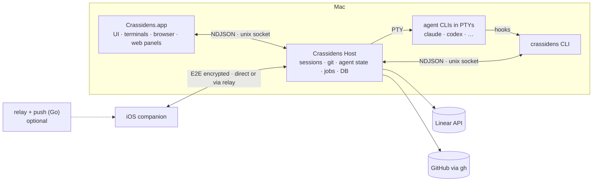
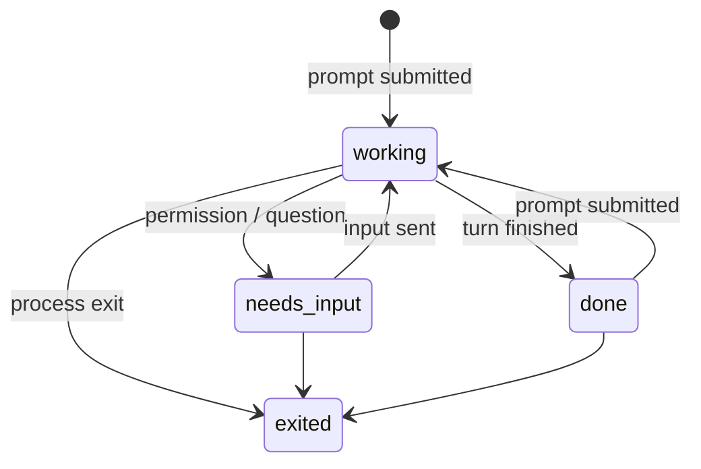

# Crassidens — System design

**Status:** proposal, 2026-10-22. This document implements [specification.md](specification.md); requirement IDs (WS-1, PI-2, …) refer to it.

Notes on Orca describe v1.4.237 as read from its source, which is where they came from rather than its docs (the two disagree in places).

## 1. Overview



The **host** is the source of truth and owns all long-lived state. The UI, the CLI, the agents (through their hooks) and the companion are all clients of one protocol, so every capability has one implementation, reachable from all four.

## 2. Processes

| Process | Owns | Lifetime |
|---|---|---|
| `Crassidens.app` | Windows, terminal rendering, `WKWebView`s (browser, Monaco, Markdown, Mermaid) | Restartable at any time without affecting sessions |
| Crassidens Host | PTYs and sessions, headless terminal state, git, agent state, the wiki and insight job queue, Linear and GitHub clients, SQLite, notifications | A launchd agent registered with `SMAppService`. Survives UI quit, crash and update |
| `crassidens` | Nothing. A stateless client | Per invocation |
| Agent processes | — | Children of the host, in PTYs |

- **Packaging:** the host is a background-only helper app (`LSUIElement`) inside the main bundle. That lets it post `UserNotifications` while the UI is closed, which a bare executable can't.
- **Browser commands** need the UI running (`WKWebView` lives there). The host launches the app on demand.
- **Upgrades:** an app update replaces the UI immediately. The host checks protocol versions in its `hello` handshake and restarts on the new binary only when no sessions are live, or when the user agrees. A later step is handing PTY master file descriptors to the new host over `SCM_RIGHTS`, so it can upgrade with sessions running.
- **Orca:** Orca has the same split. Its daemon (`src/main/daemon/`) runs as the launchd job `com.stablyai.orca.terminal.<hash>`.

## 3. Protocol and CLI

- **Transport:** newline-delimited JSON over the unix socket `~/Library/Application Support/Crassidens/host.sock`.
  - The socket is mode `0600` and the peer's uid is checked with `getpeereid`.
  - There is no TCP port and no token file. Orca uses both: localhost HTTP plus a token for hooks, and a token file for its CLI.
- **Messages:**
  - Requests are `{id, method, params}`, and responses are `{id, ok, result | error}`.
  - Methods are named `namespace.verb`: `workspace.create`, `session.send`, `browser.click`, `wiki.search`, and so on.
  - One connection carries many requests. `*.subscribe` methods stream events: session output, state changes, job progress.
- **Schema:** Swift `Codable` types in the `CrassidensProtocol` package are the source of truth. They are shared by the host, macOS app, iOS app and CLI.
  - TypeScript types for the web panels are generated from them.
  - The Go relay only needs the frame envelope, since it never sees the payload (§11).
- **Agent access to the CLI:**
  - Every PTY gets `CRASSIDENS_SESSION`, `CRASSIDENS_WORKSPACE`, and the CLI's directory first on `PATH`.
  - `crassidens skills install` writes a skill file into each detected agent's skills directory. It points the agent at `crassidens help <topic>`, and the full guides are compiled into the CLI. This is Orca's model.

## 4. Session host and terminals

- **Spawning:** `openpty` + `posix_spawn` with `POSIX_SPAWN_SETSID`, never `fork`, because the host is multithreaded.
- **Environment:** a launchd agent starts with a minimal `PATH`. The host resolves the user's login-shell environment once (`$SHELL -l -i -c env`, with a timeout) and passes it to every session.
- **Live state:**
  - The host always drains each PTY into a headless VT emulator with 5,000 lines of scrollback.
  - A client that attaches gets a snapshot, serialised as an escape-sequence stream, followed by the live output.
  - A client that falls behind is dropped back to a fresh snapshot. A slow client never blocks the PTY.
- **On disk:** an append-only output log plus a checkpoint every ~5 s, under `sessions/<id>/`. Orca does the same.
- **Cold restore after a reboot** (WS-7): the checkpoint is shown read-only, and the agent is relaunched with its resume command, e.g. `claude --resume <id>`. The agent's own session id comes from its `SessionStart` hook.
- **Terminal engine:** SwiftTerm 2.0 (MIT, macOS and iOS, optional Metal renderer), behind a `TerminalSurface` protocol in the UI and a `VTState` protocol in the host. Swapping engines later doesn't touch the rest of the code.
  - SwiftTerm's headless serialisation is unverified. If it doesn't provide one, we write it.
  - **GhosttyKit** is the stronger engine, but its embedding header `include/ghostty.h` is internal and "not designed for external use". M0 evaluates it in a time-boxed spike pinned to a commit.
  - **libghostty-vt** is a candidate for `VTState` once its API is stable.
  - **cmux** is GPL-3.0: read it for ideas, but don't copy its code.
- **Portability:** `SessionHost`, `GitKit` and `CrassidensProtocol` stay free of Apple-only frameworks. That way the host can be cross-compiled with the Swift Static Linux SDK and uploaded to SSH hosts for RM-1, the same model as Orca's `orcad`.

## 5. Agent state



**Signal sources, in priority order:**

1. Agent hooks
2. OSC notification sequences (OSC 9, OSC 777)
3. Title-spinner heuristics
4. BEL
5. Output quiescence
6. Process exit

**Hook installation:**

- **Claude Code:** each session launches with `--settings <generated file>` containing the hooks below. This needs no edits to the user's `~/.claude/settings.json`, which is where Orca puts them.
  - `SessionStart` captures the session id for resume.
  - `UserPromptSubmit` sets `working`.
  - `Stop` and `StopFailure` set `done`.
  - `Notification` with `permission_prompt`, `idle_prompt`, `agent_needs_input` or `elicitation_dialog` sets `needs-input`.
  - `PermissionRequest` enables remote approval (CP-2).
  - **To verify in M0:** that hooks from `--settings` merge with the user's own hooks rather than replacing them. If they don't, fall back to Orca's approach: a user-level hook that does nothing unless `CRASSIDENS_SESSION` is set.
- **Codex:** an entry in `~/.codex/hooks.json` that does nothing unless `CRASSIDENS_SESSION` is set (Orca's approach). It uses the `Stop` and `PermissionRequest` events. `notify` (`agent-turn-complete`) is the fallback for Codex versions without hooks.

**Hook commands:** every hook runs `crassidens hook <profile> <event>`. It reads the hook's JSON from stdin, forwards it to the host and exits. The exception is `PermissionRequest` with remote approval on: then it waits for a decision from the UI or phone and times out back to the agent's own prompt.

**Notifications and unread** (NT-1, NT-2):

- `done` is notified after a 1.5 s quiet window, and duplicates are suppressed for 5 s per workspace. Both values are taken from Orca.
- Unread is set on a move to `needs-input` or `done`, unless that session is visible in the focused window.

**Prompt delivery:** each profile declares `promptMode`:

- `argv`: the prompt is passed on the command line.
- `flag`: passed as a named option.
- `paste`: bracketed paste once the agent is ready, detected by `SessionStart` or by quiescence.

Orca's registry (`src/shared/tui-agent-config.ts`) is a ready reference for ~45 agents.

## 6. Workspaces and git

- **Git:** the `git` CLI throughout (`--porcelain=v2`, `-z`), with no libgit2. Orca does the same.
- **Creating a workspace:**
  1. `git fetch` the base branch.
  2. Resolve the base: the user's choice, then `origin/HEAD`, `origin/main`, `origin/master`.
  3. `git worktree add -b <branch> <root>/<repo>/<branch> <base>`.
  4. Copy the files listed in `copy`.
  5. Run the setup script in a visible "Setup" session. Agents start immediately or after setup, configured by `agent.waitForSetup`.
- **Branch names:** the issue's `branchName` (LN-2), or a slug of the workspace name.
- **Watching:** FSEvents per worktree, debounced, to refresh git status and diff stats for the overview (WS-6).
- **`.crassidens.yml`:**

  ```yaml
  setup: ./scripts/setup.sh        # runs in a visible session, set -e
  teardown: ./scripts/teardown.sh  # headless, 2 min timeout
  copy: [.env, .env.local]         # gitignored files copied into new worktrees
  sessions:                        # default tabs
    - { name: dev, command: pnpm dev }
  agent: { waitForSetup: true }
  exclude: [vendor/**, "**/*.lock"] # ignored by wiki and insights
  ```

  If the file is absent, Crassidens reads Orca's `orca.yaml` (`scripts.setup`, `scripts.archive`) and `.worktreeinclude`, so repos already set up for Orca work unchanged.

## 7. Review

- **Diff data:** `git status --porcelain=v2`, `git diff -z --numstat -M`, `git merge-base`, and `git show <rev>:<path>` for file contents. The scopes are unstaged, staged, and branch (from the merge base).
- **Rendering:** a Monaco `DiffEditor` in a `WKWebView` panel.
  - Assets are served through a `WKURLSchemeHandler` custom scheme, not `file://`.
  - The bridge is `WKScriptMessageHandlerWithReply` plus `callAsyncJavaScript`.
  - Annotations are Monaco view zones, stored in the host database.
- **Sending annotations** (RV-2): the host waits for the session to be idle, then sends them as a bracketed paste in Orca's format (`File:`, `Line:` or `Lines:`, `User comment:`).
- **Editing** (RV-4): WebKit has open Monaco input bugs (monaco-editor #5390, #5448, #4796, #5458). They are acceptable for review but might not be for editing, so M0 tests typing and IME input.
  - There is no good native fallback. CodeEditSourceEditor says it is "not ready for production use", and STTextView is GPLv3 unless you buy a commercial license.
- **PRs:** `gh pr create` from the workspace.

## 8. Browser

- **Setup:** one `WKWebView` per workspace, in the UI process.
  - `WKWebsiteDataStore(forIdentifier: workspaceID)` (macOS 14+) gives each workspace its own cookies and storage (BR-1).
  - The host scans session output for `localhost` and `127.0.0.1` URLs and offers to open them.
- **Injected scripts** run in a dedicated `WKContentWorld`, so page scripts can't see or tamper with them.
- **Design Mode** (BR-2): an overlay highlights elements and captures a click. The payload has:
  - selector and DOM path
  - truncated `outerHTML` and text
  - ARIA role and name
  - a fixed set of computed styles
  - the bounding box
  - a cropped `takeSnapshot(with:)` PNG

  The PNG is saved under the workspace's app-support directory, and the payload is pasted as Markdown referencing it by path. This is Orca's payload shape.
- **Automation** (BR-3):
  - `snapshot` returns a text tree of the visible, interactive elements, each with a reference (`@e12`). `click`, `fill` and `press` act on those references.
  - Events synthesised in JavaScript have `isTrusted = false`. Where a page ignores them, Crassidens falls back to native `NSEvent`s sent to the web view. M0 measures how often that is needed.
  - `logs` returns console output and failed requests captured by an injected script, because `WKWebView` has no network-inspection API.
  - The CLI calls the host, the host forwards to the UI, and the result comes back the same way.
- **Compared with Orca's Chromium + CDP:** there is no network interception or multi-engine testing, and pages render in WebKit. Agents that need more can run Playwright themselves.

## 9. Linear and GitHub

**Linear** (LN-1…5):

- **Auth:** a personal API key in the Keychain, as Orca does. OAuth can come later.
- **Client:** a small GraphQL client over `URLSession`, since there is no Swift SDK. Queries are hand-written against the fields we use: `Issue.identifier`, `branchName`, `state`, and `team.states` with `WorkflowState.type` (`started`, `completed`, …).
- **Freshness:** refreshed on focus and every few minutes. There are no webhooks, because the Mac has no public endpoint.
- **Status sync** (LN-4): the host maps workspace lifecycle events to `issueUpdate(stateId)`.
  - Linear's own GitHub integration already moves issues when a PR is opened or merged. So the defaults are on for `started` and off for review and merge, to avoid moving the issue twice.
  - The mapping is set per team.

**GitHub** (RV-3, GH-1, GH-2): everything goes through the `gh` CLI (`gh auth token`, `gh api`, `gh pr …`), as Orca does. Crassidens holds no GitHub credentials of its own.

- **PR inbox:** filled by two `gh api graphql` searches, `is:pr is:open author:@me` and `is:pr is:open review-requested:@me`, limited to the added repos. It is refreshed on focus and every few minutes.
- **Insights for a PR:** `refs/pull/<n>/head` is fetched into a host-owned detached worktree, and the insight job (§10) runs against it, with base set to the PR's merge base.

## 10. PR insights and auto wiki

### Running jobs

Insights and wiki pages are jobs in a queue in the host.

- **Execution:** each job runs one of the user's agent profiles headless (WK-5). It works in a detached worktree checked out at the exact commit, owned by the host.
- **Headless templates:** each profile declares one. The flags below are **to verify in M0**:
  - Claude Code: `claude -p --output-format json` with a read-only tool allowlist (`Read`, `Grep`, `Glob`, `Bash(git log:*)`, `Bash(git show:*)`, `Bash(git diff:*)`).
  - Codex: `codex exec --sandbox read-only --json`.
- **Read-only enforcement:** after every job, `git status --porcelain` must be empty. If it isn't, the result is discarded and the run is flagged.
- **Recorded per run:** cost and token counts, where the agent reports them.

### PR insights (PI-1…4)

1. **Context:** the diff (base…head, minus `exclude`), commit messages, PR body, linked Linear issue, and the wiki pages whose source sets overlap the changed paths.
2. **Large diffs:** grouped by component, analysed per group, then merged into one insight.
3. **Output:** JSON matching the `Insight` schema:

   ```text
   Insight {
     intent:       { summary, rationale }
     designImpact: { components: [{ name, wikiPage?, kind: interface|data|config|behaviour, summary, evidence[] }],
                     fit, newAbstractions[], newDependencies[] }
     risk:         { level: low|medium|high, reasons: [{ text, evidence[] }],
                     reviewFocus: [{ path, lines, why }] }
   }
   Evidence = { path, startLine, endLine }
   ```

4. **Evidence check:** every evidence range must fall inside the diff or exist at head. Claims that fail are dropped, and the number dropped is shown, which keeps hallucinations visible.
5. **Cache:** keyed by (repo, base, head, profile, prompt version). When head moves, the insight is marked stale (PI-3).

Prompts are versioned files in the repo. A fixture set of real PRs with expected risk flags is re-run whenever a prompt changes.

### Auto wiki (WK-1…5)

1. **Plan:** the agent proposes a list of pages. Each page has a source set: the files it covers.
2. **Write:** one job per page, producing Markdown with citations like `[src/foo.swift:10-20]` and Mermaid diagrams.
3. **Check:** citations are validated, and pages are indexed with SQLite FTS5 for WK-3 and WK-4.
4. **Incremental updates** (WK-2): when the default branch moves, run `git diff --name-only old..new`. Only pages whose source set overlaps the change are regenerated. New top-level modules trigger a re-plan.
5. **First generation** is triggered by hand, since its cost scales with repo size.
6. **Storage:** pages and their index live in the host, local only. Whether to commit them to the repo is an open question in the spec (§7).

## 11. Companion and server (Later)

- **Protocol:** the companion speaks the same protocol (§3) inside an encrypted channel.
- **Pairing:** a QR code holds the host's endpoints (LAN, Tailscale), its static X25519 public key, a one-time pairing secret, and optionally a relay URL.
- **Crypto:** CryptoKit on both ends (Curve25519, HKDF-SHA256, ChaCha20-Poly1305), with per-direction keys and counter nonces.
  - The handshake should follow the Noise IK pattern rather than a bespoke design. Orca's is bespoke: NaCl box plus an Ed25519 signature.
  - Have it reviewed before shipping.
- **Direct transport:** WebSocket via Network.framework, with Bonjour on the LAN and Tailscale elsewhere. This is enough for personal use.
- **Relay** (Go, `coder/websocket`):
  - Pairs host and phone by host id and passes opaque frames between them.
  - Has no user accounts. Hosts authenticate with their key.
- **Push:** APNs with `mutable-content`, decrypted on the phone by a Notification Service Extension. Neither the relay nor the push sender sees content, whereas Orca's push service sees titles and bodies in plaintext.
  - **Phase 1:** the host sends to APNs directly with the owner's `.p8` key.
  - **Phase 2:** a Go push gateway. `sideshow/apns2` is slow-moving, and APNs (HTTP/2 plus an ES256 JWT) is small enough to implement on the standard library.

## 12. Persistence and security

- **Database:** SQLite via GRDB at `~/Library/Application Support/Crassidens/host.sqlite`. The host is the only writer; everyone else reads and writes through the protocol.
  - Tables: `repositories`, `workspaces`, `sessions`, `annotations`, `linear_links`, `jobs`, `insights`, `wiki_pages` (with an FTS5 index), `settings`.
- **Secrets:** the Linear key, the APNs key and the companion keys live in the Keychain.
- **Local access:** the socket is limited to the current user by both file mode and uid check. No TCP listeners exist until the companion is enabled.
- **No telemetry.**

## 13. Build, test, release

```text
apps/macos/        Crassidens.app + host helper (XcodeGen project.yml)
apps/ios/          companion + notification service extension
apps/cli/          crassidens
packages/          SwiftPM: CrassidensProtocol, CrassidensKit, SessionHost, GitKit,
                   Agents, Integrations, Insights, TerminalUI, WebPanels
web/               TypeScript + Vite: Monaco panels, Tiptap, Mermaid, injected browser scripts
server/            Go: relay, push
docs/
```

- **Tooling:**
  - Swift 6 language mode, with strict concurrency.
  - XcodeGen generates the Xcode project, which isn't committed, and `xcodebuild` builds it, so agents can build without opening Xcode. Tuist was rejected because it has grown into a whole platform.
  - SwiftPM alone can't produce an `.app`.
- **Tests:**
  - `swift test` for the packages: `GitKit` against temporary repos, `SessionHost` with real PTYs, and `Insights` with fixture agent output.
  - `xcodebuild test` for the apps, `go test` for the server, and a web build check.
- **CI:** GitHub Actions on macOS runners.
- **Release:** Developer ID signing, notarisation and Sparkle on macOS; TestFlight on iOS. Both need an Apple Developer Program membership.

## 14. Milestones

| | Scope |
|---|---|
| **M0** | Time-boxed spikes:<br>• PTY, headless VT, snapshot and attach<br>• Claude `--settings` hook merging and Codex hooks<br>• Monaco typing in `WKWebView`<br>• `WKWebView` automation (synthetic vs native events)<br>• GhosttyKit embedding<br>• headless agent flags |
| **M1** | Core loop: host, repos, workspaces, sessions, terminal, agent state, notifications, workspace view, overview, basic CLI and hooks |
| **M2** | Review and annotations, Linear (LN-1…5) |
| **M3** | Browser (BR-1…4) |
| **M4** | PR insights and GitHub PR tooling |
| **M5** | Auto wiki |
| **M6** | Companion, then SSH workspaces and usage tracking |

## 15. Risks

| Risk | Mitigation |
|---|---|
| Ghostty's embedding API is unsupported | SwiftTerm is the baseline, behind `TerminalSurface` |
| Monaco input bugs in WebKit | Review depends on it, editing is secondary; spiked in M0 |
| `WKWebView` automation is weaker than CDP | Native-event fallback; agents can run their own Playwright |
| Agent hook APIs change often | One adapter per profile, plus terminal-signal fallbacks |
| Insight hallucinations | Schema validation, the evidence check, versioned prompts, fixtures |
| Wiki cost on large repos | Manual first run, incremental updates, `exclude` |
| Agents are less fluent in Swift than TypeScript | Small packages, strict tests, conventions in `AGENTS.md` |

## 16. Decisions

All proposed on 2026-10-22, and accepted when this proposal merges.

| # | Decision |
|---|---|
| D1 | Native Swift. macOS 26+ on Apple silicon and iOS 26+ only |
| D2 | A separate host process owns sessions and state. The UI, CLI and companion are its clients |
| D3 | NDJSON over a unix socket, with `Codable` types as the schema |
| D4 | SwiftTerm 2.0 as the baseline terminal engine, behind a protocol |
| D5 | The `git` and `gh` CLIs rather than libraries |
| D6 | Monaco in `WKWebView` for diffs, with editing to be confirmed in M0 |
| D7 | WebKit browser driven by injected scripts, not Chromium |
| D8 | Wiki and insights run the user's own agent CLIs headless and read-only |
| D9 | XcodeGen + `xcodebuild`, and SwiftPM for packages |
| D10 | Go for the relay and push server, deferred until the companion needs it |
